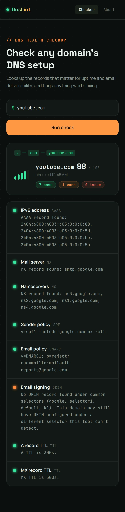
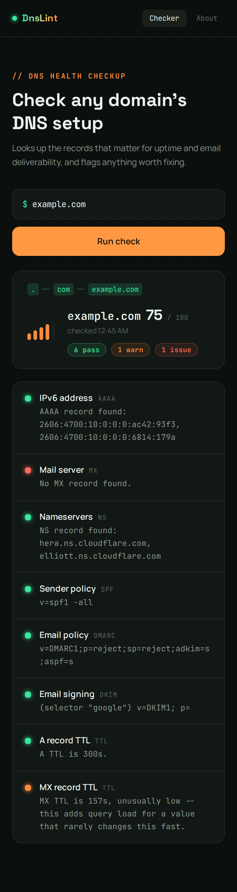
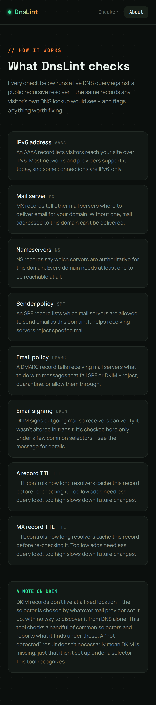
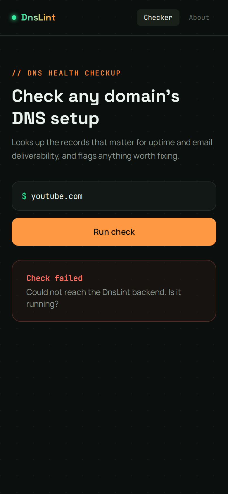
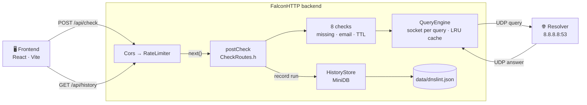
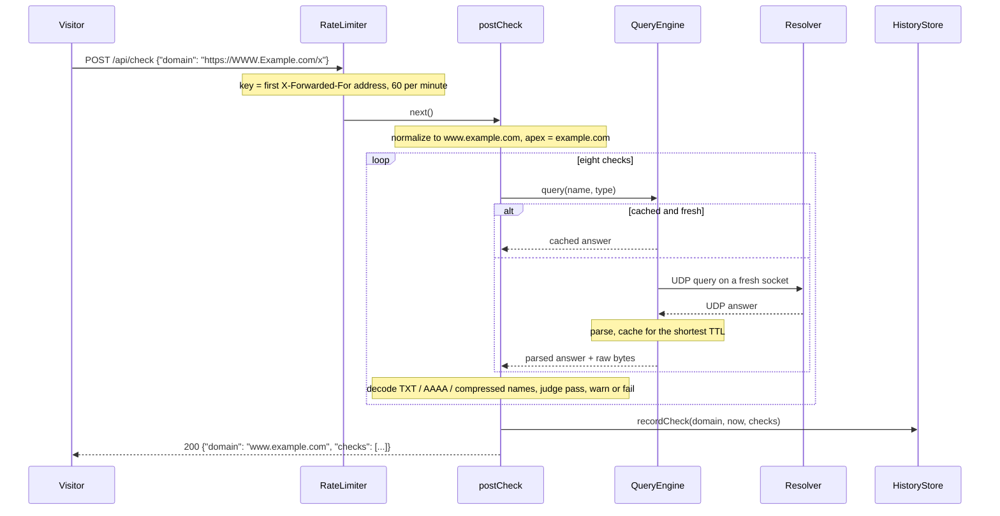

<p align="center">
  
</p>

<p align="center">
  
  
  
  
</p>

<p align="center">
  
</p>

<p align="center"><sub><b>CI / CD</b></sub></p>
<p align="center">
  <a href="https://github.com/privateMwb/DnsLint/actions/workflows/build.yml">
    
  </a>
  <a href="https://github.com/privateMwb/DnsLint/actions/workflows/frontend.yml">
    
  </a>
  <a href="https://github.com/privateMwb/DnsLint/actions/workflows/release.yml">
    
  </a>
  <a href="https://github.com/privateMwb/DnsLint/actions/workflows/demo-image.yml">
    
  </a>
</p>

<p align="center"><sub><b>Code Quality &amp; Safety</b></sub></p>
<p align="center">
  <a href="https://github.com/privateMwb/DnsLint/actions/workflows/sanitizers.yml">
    
  </a>
  <a href="https://github.com/privateMwb/DnsLint/actions/workflows/clang-tidy.yml">
    
  </a>
  <a href="https://github.com/privateMwb/DnsLint/actions/workflows/clang-format.yml">
    
  </a>
  <a href="https://github.com/privateMwb/DnsLint/actions/workflows/codeql.yml">
    
  </a>
  <a href="https://github.com/privateMwb/DnsLint/actions/workflows/cflite_pr.yml">
    
  </a>
</p>

<p align="center"><sub><b>Documentation</b></sub></p>
<p align="center">
  <a href="https://github.com/privateMwb/DnsLint/actions/workflows/docs.yml">
    
  </a>
</p>

<p align="center">
  
</p>

<p align="center">DnsLint is a DNS health checkup tool: point it at any domain and it runs live DNS queries to flag missing records, misconfigured email security, and TTL issues, showing the <i>actual decoded values</i> (real IPv6 addresses, real mail server and nameserver names, the real SPF and DMARC text) rather than a plain pass/fail. It is a C++ backend built on <a href="https://github.com/privateMwb/DnsResolver">DnsResolver</a>, <a href="https://github.com/privateMwb/FalconHTTP">FalconHTTP</a>, <a href="https://github.com/privateMwb/RateThrottle">RateThrottle</a> and <a href="https://github.com/privateMwb/MiniDatabase">MiniDatabase</a>, with a React frontend.</p>

<br>

> [!NOTE]
> **Status: v1.0.0.** Eight checks run live against any domain, every run is saved and readable back, and the
> API is rate limited. Unit tests (against an in-process mock DNS server), sanitizer runs, fuzzing and CodeQL run
> in CI. The live demo is at [dns-lint.vercel.app](https://dns-lint.vercel.app), with the backend on Render, so
> **saved check history is lost whenever the backend is rebuilt or spins down** unless a persistent disk is
> attached (see [Deployment](#deployment)). Linux only so far.

<p align="center">
  
</p>

<details>
<summary>More screenshots</summary>

<p align="center">
  
  
  
</p>

</details>

<br>

## 📑 Table of Contents

- [Features](#features)
- [How It Works](#how-it-works)
- [Requirements](#requirements)
- [Stack](#stack)
- [Installation](#installation)
- [Quick Start](#quick-start)
- [Running the Demo](#running-the-demo)
- [Frontend](#frontend)
- [API](#api)
- [Checks](#checks)
- [Docker](#docker)
- [Deployment](#deployment)
- [Project Structure](#project-structure)
- [Roadmap](#roadmap)
- [Design Notes](#design-notes)
- [Development](#development)
- [Documentation](#documentation)
- [Contributing](#contributing)
- [Changelog](#changelog)
- [Security](#security)
- [License](#license)

<br>
## <a id="features"></a>✨ Features

- **Live DNS decoding, not just pass/fail** — AAAA, MX and NS checks show the actual resolved values (real IPv6 addresses, real mail server and nameserver names), decoded straight from the DNS wire format, including compression-pointer-encoded names.
- **Email security checks** — SPF and DMARC show the matched TXT record on a pass. DKIM is checked best-effort against four common selectors and reports a *warning*, never a false "missing", when a non-standard selector is in use.
- **Apex-domain-aware routing** — MX, NS and DMARC are looked up on the domain's apex whatever subdomain was submitted (checking `www.example.com` still evaluates `example.com`'s mail setup), since those records are apex-level by nature.
- **TTL sanity checks** — flags A and MX TTLs that are unusually low (needless query load) or unusually high (a future fix would take long to propagate).
- **Honest about failure** — a resolver that doesn't answer is a *warning* ("query timed out"), never a made-up "no record found".
- **Input that can't hurt** — a pasted URL (`https://WWW.Example.com/x?y=1`) is cleaned to its host, the name must contain a dot and fit in 255 characters, and an over-long label is refused before anything is sent.
- **Persisted check history** — every run is saved through MiniDB and readable back with `GET /api/history?domain=...`, newest first.
- **Response caching** — repeat checks against the same domain skip the DNS round trip while cached, for as long as the records' own shortest TTL allows (never longer than a real resolver would hold them).
- **Safe under concurrency** — every query uses its own UDP socket, so simultaneous checks never read each other's answers (see [Design Notes](#design-notes) for the bug this fixed).
- **Rate-limited API** — each check fans out into about a dozen real UDP queries on a visitor's behalf, so the API allows 60 requests per minute per client.
- **Tested, sanitized, and fuzzed** — a unit test suite that runs every check against a mock DNS server on every compiler and build type, ASan, UBSan and TSan runs over the tests and the real server, and ClusterFuzzLite harnesses for domain input, the rdata decoders and the whole DNS response path.

<div align="right"><a href="#-table-of-contents"></a></div>

## <a id="how-it-works"></a>🧠 How It Works

One backend process runs FalconHTTP's middleware chain: CORS, then a per-client rate limiter, then the router. A check request normalizes the domain, runs eight checks through one shared `QueryEngine` (one UDP round trip each, cached by name and type), saves the run through MiniDB, and answers with the results.



What happens on one `POST /api/check`:



The request path, the checks, the cache and the trade-offs are written up in [docs/ARCHITECTURE.md](docs/ARCHITECTURE.md).

<div align="right"><a href="#-table-of-contents"></a></div>

## <a id="requirements"></a>📋 Requirements

- A C++23-conformant compiler (GCC or Clang on Linux; see [backend/README.md](backend/README.md)) and CMake 3.20+
- Node.js 22+ and npm, for the frontend (Vite 8 needs 20.19 or newer)
- Git submodules initialized: DnsLint is a consumer application built on four of its author's own projects and needs their source present to build (see [Stack](#stack))
- Outbound UDP to a DNS resolver (`8.8.8.8:53` by default), for the checks themselves
- *(Optional)* Docker, to build the deployment image

<div align="right"><a href="#-table-of-contents"></a></div>

## <a id="stack"></a>🔗 Stack

DnsLint is assembled from four libraries, pulled in as git submodules under `backend/external/`:

| Library | CMake target | Role |
|---|---|---|
| [DnsResolver](https://github.com/privateMwb/DnsResolver) | `DnsPro` | Builds the outbound query and parses the response packet |
| [FalconHTTP](https://github.com/privateMwb/FalconHTTP) | `FalconHTTP` | HTTP server, router, CORS and the middleware chain |
| [RateThrottle](https://github.com/privateMwb/RateThrottle) | `ThrottlePro` | The rate limiter wrapped by `RateLimiterMiddleware` |
| [MiniDatabase](https://github.com/privateMwb/MiniDatabase) | `MiniDB` | The embedded database behind the check history |

All four are built from source with `add_subdirectory()`; each vendors its own dependencies, some as nested submodules, so there is no package manager step. The frontend is **React 19**, **Vite 8**, **TypeScript** and **Tailwind CSS 4**, with `react-router-dom` for its two pages.

<div align="right"><a href="#-table-of-contents"></a></div>

## <a id="installation"></a>📦 Installation

Clone with submodules and build the backend:

```bash
git clone --recurse-submodules https://github.com/privateMwb/DnsLint.git
cd DnsLint/backend
cmake -S . -B build -DCMAKE_BUILD_TYPE=Release
cmake --build build
mkdir -p data   # the check history is written here
```

Already cloned without `--recurse-submodules`? Run `git submodule update --init --recursive` from the repository root.

Then install the frontend's dependencies, from the repository root:

```bash
npm --prefix frontend install
cp frontend/.env.example frontend/.env.local   # set VITE_API_BASE_URL if the backend isn't on localhost:8080
```

Check history is saved to `backend/data/dnslint.json`. Delete the file to start fresh.

<div align="right"><a href="#-table-of-contents"></a></div>

## <a id="quick-start"></a>🚀 Quick Start

The fastest way to see DnsLint work is the backend plus the frontend. From the repository root, with the backend built:

```bash
(cd backend && ./build/dnslint_backend)    # the backend on http://localhost:8080
npm --prefix frontend run dev              # the frontend on http://localhost:5173 (second terminal)
```

Or skip the frontend and use `curl`:

```bash
# Run a check (a pasted URL is fine: it is cleaned to the host)
curl -X POST http://localhost:8080/api/check \
  -H "Content-Type: application/json" \
  -d '{"domain": "example.com"}'

# Read the saved runs back, newest first
curl "http://localhost:8080/api/history?domain=example.com"
```

Follow [docs/DEMO.md](docs/DEMO.md) for a short guided tour. The checks send real DNS queries from the backend, so it needs outbound UDP on port 53.

<div align="right"><a href="#-table-of-contents"></a></div>

## <a id="running-the-demo"></a>▶️ Running the Demo

One terminal per process (from the repository root):

```bash
(cd backend && ./build/dnslint_backend)        # the backend on :8080
npm --prefix frontend run dev                  # the frontend on :5173
./scripts/check-demo.sh http://localhost:8080  # the end-to-end check (runs two real checks)
```

Check a couple of domains in the frontend, then try one with problems and stop the backend to see the *Check failed* card. The backend has no environment variables; the frontend has one build-time setting, `VITE_API_BASE_URL` (the backend's base URL, default `http://localhost:8080`), which goes in `frontend/.env.local` for local development.

<div align="right"><a href="#-table-of-contents"></a></div>

## <a id="frontend"></a>🖥️ Frontend

```bash
npm --prefix frontend install
npm --prefix frontend run dev          # http://localhost:5173
```

<p align="center"></p>

It uses a dark palette with LED-style status colors (green pass, orange warn, red fail), mono type for data, and a mint-to-ember gradient accent (the same colors as the artwork above). It reads `http://localhost:8080` by default; point it elsewhere with `VITE_API_BASE_URL` at build time.

| Element | What it does |
|---|---|
| **Check form** | Takes a domain (or a pasted URL) and runs the check |
| **Resolution trace** | A `. → com → example.com` strip that plays while the queries run, then settles on the checked domain |
| **Summary** | The domain, a score out of 100, and the count of passes, warnings and issues |
| **Result rows** | One row per check with a status LED, the check's name and record type, and the decoded value |
| **Error states** | A *Check failed* card when the backend can't be reached, and a readable message for `429 Too Many Requests` |
| **About page** | What each check means and why it matters |

<div align="right"><a href="#-table-of-contents"></a></div>

## <a id="api"></a>🔌 API

```bash
curl -X POST localhost:8080/api/check -H "Content-Type: application/json" -d '{"domain": "example.com"}'
curl "localhost:8080/api/history?domain=example.com"   # up to 20 past runs, newest first
curl localhost:8080/api/health                          # liveness: "ok"
```

| Endpoint | Purpose | Statuses |
|---|---|---|
| `POST /api/check` | Run all eight checks for `{"domain": "..."}` and save the run | `200`, `400` malformed JSON / missing or non-string `domain` / unacceptable domain |
| `GET /api/history?domain=...` | The saved runs for a domain, newest first, at most 20 | `200`, `400` missing or unacceptable `domain` |
| `GET /api/health` | Liveness check | `200` |

Any endpoint can also answer `429 Too Many Requests` once a client passes 60 requests in a minute.

A successful `POST /api/check` returns the cleaned domain and one entry per check (shortened here; values are illustrative):

```json
{
  "domain": "example.com",
  "checks": [
    { "name": "missing_aaaa", "status": "pass", "message": "AAAA record found: 2606:2800:21f:cb07:6820:80da:af6b:8b2c" },
    { "name": "missing_mx",   "status": "fail", "message": "No MX record found." },
    { "name": "ttl_a",        "status": "pass", "message": "A TTL is 3600s." }
  ]
}
```

and `GET /api/history` returns the same `checks` array for each run:

```json
{
  "domain": "example.com",
  "runs": [
    { "domain": "example.com", "checkedAt": 1786504800, "checks": [ /* as above */ ] }
  ]
}
```

`status` is always `pass`, `warn` or `fail`, and `checkedAt` is Unix time in seconds. The domain is normalized the same way for both endpoints, so a history lookup for a pasted URL still matches what was saved.

> [!WARNING]
> `GET /api/history` returns the past runs for **any** domain to anyone who asks, including when each was run, and the history is never pruned. Checked domain names are also sent in clear text to the resolver. See [SECURITY.md](SECURITY.md).

<div align="right"><a href="#-table-of-contents"></a></div>

## <a id="checks"></a>🔍 Checks

Eight checks run on every request, in this order. Each returns `pass`, `warn` or `fail`, with the decoded value in its message.

| Check | Looks at | Name queried | Pass | Warn | Fail |
|---|---|---|---|---|---|
| `missing_aaaa` | AAAA | the submitted domain | an IPv6 address exists (shown) | query failed or timed out | no AAAA record |
| `missing_mx` | MX | the apex | a mail server exists (shown) | query failed or timed out | no MX record |
| `missing_ns` | NS | the apex | nameservers exist (all shown) | query failed or timed out | no NS record |
| `spf_present` | TXT `v=spf1` | the submitted domain | the SPF record (shown) | query failed or timed out | no SPF record |
| `dmarc_present` | TXT `v=DMARC1` at `_dmarc.` | the apex | the DMARC record (shown) | query failed or timed out | no DMARC record |
| `dkim_present` | TXT `v=DKIM1` under `google`, `selector1`, `default`, `k1` | the submitted domain | a record found (selector shown) | none found under those selectors, or the query failed | never |
| `ttl_a` | the lowest A TTL | the submitted domain | 300 s to 48 h | under 300 s, over 48 h, no record, or query failed | never |
| `ttl_mx` | the lowest MX TTL | the apex | 300 s to 48 h | under 300 s, over 48 h, no record, or query failed | never |

The apex is the last two labels of the name (`www.example.com` → `example.com`), a deliberately naive rule that does not know about suffixes such as `co.uk`. DKIM can only *warn* because a domain using a selector this tool doesn't know is indistinguishable from one with none. How each check is implemented, and how it is tested, is in [docs/ARCHITECTURE.md](docs/ARCHITECTURE.md).

<div align="right"><a href="#-table-of-contents"></a></div>

## <a id="docker"></a>🐳 Docker

The `Dockerfile` builds the backend as a multi-stage image:

```bash
docker build -t dnslint .
docker run --rm -p 8080:8080 -v dnslint-data:/app/data dnslint
./scripts/check-demo.sh http://localhost:8080
```

- **Build stage:** an `ubuntu:24.04` image with the toolchain (`build-essential`, `cmake`, `git`) compiles `dnslint_backend` in Release mode, with the unit tests and the submodules' tests, benchmarks, regression suites and examples switched off.
- **Nested submodules:** `init-nested-submodules.sh` runs first. It walks the tree for every `.gitmodules` file and clones anything still empty, which is what makes the build work on hosts that clone only the top-level submodules. It needs no `.git` metadata.
- **Final stage:** a clean `ubuntu:24.04` with only `libstdc++6` and the compiled binary, to keep the image small. The binary name is the `BINARY_NAME` build argument (default `dnslint_backend`).

> [!CAUTION]
> **`/app/data` is created inside the image layer, so without a mounted volume it is not persistent.** Everything a container stores, the saved check history included, is gone when it is rebuilt or replaced. Mount a volume at `/app/data`, as in the command above, if you want history to survive.

<div align="right"><a href="#-table-of-contents"></a></div>

## <a id="deployment"></a>☁️ Deployment

DnsLint deploys as two independent pieces, because they are different kinds of workload:

**Frontend → Vercel.** `frontend/` is a static Vite build with no server-side logic, which suits Vercel's free Hobby tier: deploy on push, no credit card. Set `VITE_API_BASE_URL` (Vercel project → Environment Variables) to the backend's real URL before deploying. It is read at build time, so changing it needs a redeploy.

**Backend → not Vercel.** `backend/` is a long-running process that binds a persistent TCP port, sends live UDP DNS queries and writes `data/dnslint.json` to disk. Vercel runs short-lived serverless functions with no persistent port and no durable filesystem, so it cannot host this. The backend runs on **Render** instead, built from the repo's `Dockerfile`.

```bash
# Render:  New → Web Service, pick this repo, runtime Docker, health check path /api/health
# Vercel:  import the repo, Root Directory = frontend, set VITE_API_BASE_URL
```

`render.yaml` is a Render Blueprint for the backend, and `frontend/vercel.json` carries the SPA rewrite (so `/about` survives a reload) and a few security headers. Check a deployed backend from outside with `scripts/check-demo.sh <backend-url> [frontend-origin]`; the *Demo image* workflow runs the same check against the Docker image in CI. The step-by-step guide is in [docs/DEPLOYMENT.md](docs/DEPLOYMENT.md).

> [!WARNING]
> **Saved history is lost on every redeploy and, on Render's free plan, after every spin-down** (15 minutes without traffic), unless a persistent disk is mounted at `/app/data`. Running checks works either way. The free plan also sleeps when idle, so the first visit after a quiet spell takes about a minute.

> [!NOTE]
> Behind Render's proxy, the rate limiter reads each visitor's address from `X-Forwarded-For`, so every visitor gets their own 60-requests-per-minute bucket. See [Design Notes](#design-notes) for what that trust assumes.

<div align="right"><a href="#-table-of-contents"></a></div>

## <a id="project-structure"></a>🗂️ Project Structure

```
DnsLint/
├── backend/                C++ backend (CMake)
│   ├── include/            CheckResult.h, QueryEngine.h
│   ├── src/
│   │   ├── checks/         MissingRecordChecks.h, EmailSecurityChecks.h, TtlChecks.h, RDataDecode.h
│   │   ├── database/       HistoryStore (MiniDB-backed check history)
│   │   ├── middleware/     RateLimiterMiddleware.h (RateThrottle on FalconHTTP)
│   │   ├── routes/         CheckRoutes.h (POST /api/check, GET /api/history)
│   │   ├── QueryEngine.cpp UDP query, parse, cache
│   │   └── main.cpp        Server: middleware chain + routes on :8080
│   ├── tests/              Unit tests + the in-process mock DNS server
│   ├── fuzz/               ClusterFuzzLite harnesses (fuzz_*.cpp) and seed corpora
│   ├── data/               Runtime data: dnslint.json (check history); mount a volume here
│   └── external/           The four submodules (dnsresolver, falconhttp, ratethrottle, minidatabase)
│
├── frontend/               React + Vite + TypeScript + Tailwind app (vercel.json: SPA rewrite and headers)
├── scripts/                check-demo.sh (checks a deployed backend from outside),
│                           capture-screenshots.mjs (README screenshots)
├── docs/                   ARCHITECTURE.md, DEMO.md, DEPLOYMENT.md, Doxyfile, assets/ (screenshots)
├── .clusterfuzzlite/       Fuzzing build: Dockerfile, build.sh, project.yaml
├── .github/                Workflows, release notes, README assets, CODEOWNERS, Dependabot,
│                           rulesets/main-protection.json (branch ruleset)
│
├── Dockerfile              Backend image (multi-stage)
├── render.yaml             Render Blueprint for the backend
├── init-nested-submodules.sh   Clones submodules a host didn't recurse into
├── .dockerignore
├── .clang-format
├── .clang-tidy
├── README.md
├── CONTRIBUTING.md
├── CHANGELOG.md
├── SECURITY.md
└── LICENSE
```

<div align="right"><a href="#-table-of-contents"></a></div>

## <a id="roadmap"></a>🗺️ Roadmap

| Phase | Goal | Status |
|:-:|---|:-:|
| 0 | Repo scaffold from a shared app template; one build linking all four libraries | ✅ |
| 1 | `QueryEngine`: one UDP query to a recursive resolver, parsed with DnsResolver | ✅ |
| 2 | The checks: missing records, email security (SPF, DMARC, DKIM) and TTL | ✅ |
| 3 | `POST /api/check` and `GET /api/history`, with the history saved through MiniDB | ✅ |
| 4 | The React frontend: form, resolution trace, summary and result rows | ✅ |
| 5 | Hardening: response cache, rate limiting, apex routing, input normalization | ✅ |
| 6 | Stretch: unit tests, sanitizers, fuzzing, CI, Render and Vercel deployment | ✅ <sub>history not persistent on the free plan</sub> |

<div align="right"><a href="#-table-of-contents"></a></div>

## <a id="design-notes"></a>🔬 Design Notes

No benchmark numbers are published for DnsLint: a check's wall time is dominated by network round trips to the resolver, not by this code. Timings depend on where it runs.

**Key decisions**

- **A fixed recursive resolver.** One UDP round trip per check to `8.8.8.8:53`, instead of resolving each domain's own authoritative nameserver first. Simpler, and it matches what most visitors' own DNS sees. The trade-off is that it can show cached or propagating state rather than a domain owner's very latest change.
- **One socket per query.** The server shares one `QueryEngine` across four worker threads. An earlier version kept a single socket on the engine, so two checks running at once could read each other's DNS responses (and the lazy open was a data race). A concurrency test caught it: simultaneous queries came back with answers meant for other domains. Each `query()` now opens and closes its own socket, which also gives every query a fresh source port.
- **Cache for the shortest TTL.** A successful answer is cached for the lowest TTL among its records, like a real resolver, and an empty answer for 60 seconds. A timeout or a parse failure is never cached, so a blip is not remembered as an answer.
- **Judge only what was actually learned.** "Couldn't ask" (timeout, bad reply) is a warning; only a successful, empty answer is "no record". SPF and DMARC used to fail on a timeout; they now warn like the rest.
- **Keep the raw bytes.** A compressed name inside an answer is a pointer into the *original* packet, so `QueryResult` keeps the response bytes next to the parsed message, and `RDataDecode.h` decodes against them. Every decoder treats the bytes as hostile: overrunning lengths, pointer loops and wild offsets end in an empty result, and a fuzz harness runs hostile responses through the whole path.
- **Sort, then limit.** MiniDB's `select()` stops scanning once it reaches the limit and only then sorts, which returned the *oldest* runs once a domain had more than the limit. `HistoryStore` sorts everything for the domain and cuts to the limit itself.
- **Normalize at the server, and twice.** Whitespace is trimmed before the scheme, path, query and port are stripped and again afterwards, so `"example.com /x"` can't leave a trailing space inside the queried name.
- **A failed history store degrades, it doesn't fail.** If the history can't be opened or written, the check still answers: the visitor is owed their result.

**Known limits** — there are no accounts and no authentication, and the check history is public and shared: anyone can read the past runs for any domain, and nothing is ever pruned; checked names are sent in clear text to the resolver (Google's, by default), so don't check names you consider private on a shared instance; the rate limiter keys on the first `X-Forwarded-For` address, which a caller can set to anything if they reach the backend directly, and when the header is missing every caller shares one bucket; there is no DNSSEC validation, so a spoofed or poisoned answer is reported as real; the resolver must be an IPv4 literal and queries are UDP only, with no TCP fallback for truncated responses; the apex is the last two labels, so `example.co.uk` is treated as `co.uk`; DKIM can only look under four common selectors; `/app/data` is not a persistent volume on Render, so redeploys and free-tier spin-downs delete the history; the unit tests cover the checks, `QueryEngine`, the domain handling and `HistoryStore`, but the route handlers and `main.cpp` are only exercised end to end (`scripts/check-demo.sh`, the sanitizer jobs), and there are no frontend tests; no coverage numbers are collected; Linux only, and nothing has been tried on macOS or MSVC.

<div align="right"><a href="#-table-of-contents"></a></div>

## <a id="development"></a>🛠️ Development

**Build the backend** (Debug by default):

```bash
cd backend
cmake -B build -DCMAKE_BUILD_TYPE=Debug
cmake --build build
```

**Run the unit tests** (built by default; `-DDNSLINT_BUILD_TESTS=OFF` skips them):

```bash
cd backend
cmake --build build --target dnslint_tests
./build/dnslint_tests
```

They run every check and `QueryEngine` against an in-process mock DNS server on `127.0.0.1`, so they need no network.

**Run the frontend dev server**, lint it, and build it for production:

```bash
cd frontend
npm run dev
npm run lint && npm run format:check
npm run build
```

**Check the backend end to end** against a live instance (runs two real checks):

```bash
./scripts/check-demo.sh http://localhost:8080
```

**Check formatting and static analysis locally**, the same checks CI runs (`.clang-format` and `.clang-tidy` are at the repository root):

```bash
find backend/include backend/src \( -name "*.h" -o -name "*.cpp" \) -exec clang-format --dry-run --Werror {} +
clang-tidy -p backend/build $(find backend/include backend/src -name "*.cpp")
```

**Fuzzing:** every `backend/fuzz/fuzz_<target>.cpp` becomes its own harness with no build-file edit (CMake option `DNSLINT_BUILD_FUZZERS`), and its seed inputs go in `backend/fuzz/corpus/fuzz_<target>/`. The harnesses cover the domain input, the rdata decoders and the whole DNS response path. ClusterFuzzLite runs them for a few minutes on pull requests and for longer every night.

The sanitizer workflow runs the unit tests and then boots the real backend under ASan/UBSan and under TSan, exercising it with real requests, including concurrent `POST /api/check` calls. See [CONTRIBUTING.md](CONTRIBUTING.md) for what CI covers.

<div align="right"><a href="#-table-of-contents"></a></div>

## <a id="documentation"></a>📖 Documentation

| Document | What's inside |
|---|---|
| [docs/ARCHITECTURE.md](docs/ARCHITECTURE.md) | How it works: the request path, domain handling, the checks, QueryEngine, HistoryStore, the frontend, tests and fuzzing |
| [docs/DEMO.md](docs/DEMO.md) | A short guided tour: run a check, paste a URL, read the history, hit the rate limit |
| [docs/DEPLOYMENT.md](docs/DEPLOYMENT.md) | Hosting: Render backend, Vercel frontend, behavior to expect, troubleshooting |
| [backend/README.md](backend/README.md) | Building the backend, its targets and its layout |
| [frontend/README.md](frontend/README.md) | Working on the frontend |
| [CONTRIBUTING.md](CONTRIBUTING.md) | Setup, tests, code style, and the pull request checklist |
| [SECURITY.md](SECURITY.md) | Security model, scope, and how to report a vulnerability |
| [CHANGELOG.md](CHANGELOG.md) | Notable changes per release |

The generated API reference (Doxygen, from `docs/Doxyfile`) is published at **https://privatemwb.github.io/DnsLint/**.

<div align="right"><a href="#-table-of-contents"></a></div>

## <a id="contributing"></a>🤝 Contributing

Issues and pull requests are welcome. [CONTRIBUTING.md](CONTRIBUTING.md) covers setup, running the checks, code style, and a pull request checklist. In short:

- Run `clang-format` and `clang-tidy` locally on changed backend files (see [Development](#development)): CI enforces both
- Run `npm run lint` and `npm run format:check` on changed frontend files
- Run `dnslint_tests` before opening a pull request that touches `backend/`, and add a test for what you change. Anything that asks DNS a question can be tested against the mock server in `backend/tests/support/mockDns.h`
- Make sure `docker build .` still succeeds if you touched the backend or the `Dockerfile`

<div align="right"><a href="#-table-of-contents"></a></div>

## <a id="changelog"></a>📝 Changelog

Notable changes are recorded in [CHANGELOG.md](CHANGELOG.md); release notes are published on the [Releases](https://github.com/privateMwb/DnsLint/releases) page.

<div align="right"><a href="#-table-of-contents"></a></div>

## <a id="security"></a>🔒 Security

Please don't report a suspected vulnerability in a public issue. Use GitHub's private reporting instead: this repository's **Security** tab, then **Report a vulnerability**, so it can be fixed before it's disclosed. Details are in [SECURITY.md](SECURITY.md).

> [!WARNING]
> DnsLint has **no accounts or authentication**, its check history is public and shared, checked domain names are sent to a third-party resolver in clear text, and there is no TLS unless a proxy provides it. Read the security model in [SECURITY.md](SECURITY.md) before exposing an instance to people you don't trust.

<div align="right"><a href="#-table-of-contents"></a></div>

## <a id="license"></a>📄 License

MIT — see [LICENSE](LICENSE) for details.

<p align="center">
  <sub>Built with C++23 and React</sub>
</p>

<p align="center">
  <a href="#-table-of-contents"></a>
</p>
